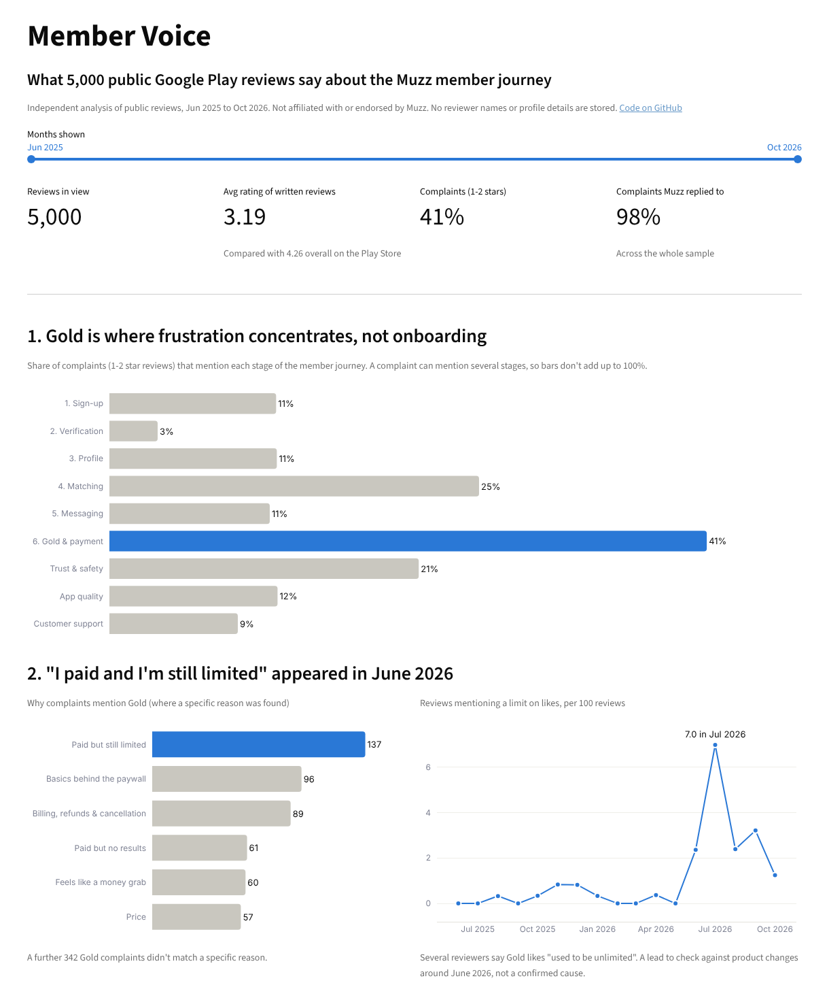

# Member Voice - where Muzz members get stuck, from their own reviews

An independent analysis of the newest 5,000 public Google Play reviews of Muzz (June 2025 to October 2026). It maps what members complain about onto the member journey (sign-up, verification, profile, matching, messaging, Gold), finds out why members are unhappy with Gold, and detects weeks where complaints spiked.

**Live dashboard:** [member-voice.streamlit.app](ADD-LINK) · **Stack:** Python, VADER, BigQuery (SQL views), Streamlit, Plotly

> This is an independent project built from public data for a job application. It is not affiliated with or endorsed by Muzz. No reviewer names or profile details are stored, and review IDs are hashed.

## Questions
1. Where in the member journey do complaints cluster?
2. When members complain about Gold, what exactly is the problem?
3. Were there weeks when complaints spiked, and why?
4. Did any app release make things worse?
5. How often do unhappy reviewers get a reply?

## Findings
1. **Gold is where frustration concentrates, not onboarding.** 42% of complaints (1-2 star reviews) mention Gold or payment, ahead of matching (26%) and trust & safety (22%). Sign-up (11%) and verification (3%) come up far less.
2. **"I paid and I'm still limited" appeared suddenly in June 2026.** Complaints that paying members still run out of likes stayed below 1 per 100 reviews for 12 months, then rose to 7 per 100 in July 2026. Several reviewers say Gold likes "used to be unlimited". That's worth checking against product changes made around June.
3. **The worst weeks were incidents, mostly releases.** The single worst week, 25-31 May 2026, had complaints at 3.1x the normal level, most of them "Something went wrong" errors and login failures. Three releases each cut the average rating by more than half a star: 8.65.2a (October 2025, the lowest-rated version at 2.93, with members calling the new design complicated and saying free filters had moved behind the paywall), 8.68.1a (November 2025) and 8.78.1a (April 2026, "can't continue matches after the update"). The spike detector flagged October 2025 and April 2026 without being told where to look.
4. **Reviewers are polarised.** 45% give 5 stars and 37% give 1 star, and written reviews average 3.19 against Muzz's 4.26 Play Store rating. Reviews show *what* hurts, not *how many* members it hurts.
5. **Muzz replies to 98% of complaints**, which is a strong sign of how seriously member feedback is taken.



## How it works

```
Google Play + App Store reviews
   -> collect_reviews.py        (public reviews, no personal data)
   -> enrich.py                 (complaint flag, sentiment, journey stages, Gold reasons)
   -> BigQuery                  (8 SQL views: friction funnel, Gold issues, spike detector, release quality...)
   -> build_dashboard_data.py   (same logic in pandas, aggregates only)
   -> app.py                    (Streamlit + Plotly dashboard)
```

- **Complaint** = a 1-2 star review. Star ratings are a more reliable "unhappy" signal than text sentiment. VADER scores complaint language like "app crashes after the update" as neutral, and `enrich.py` prints how often the two agree.
- **Journey stage** = keyword rules that tag each review with every stage it mentions. A review can mention several, so they're stored together and split out with `UNNEST(SPLIT(...))` in BigQuery.
- **Success story** = the review says the member met their partner or got married.

## Limitations
- **App store reviewers aren't representative.** They lean towards the very happy and the very unhappy. This shows *what* hurts, not how many members it hurts. `TRACKING_PLAN.md` shows how I'd check that with product data.
- **No market split.** Google Play returned the same reviews for every country (checked automatically, 100% overlap), so Android rows are labelled `GLOBAL`. Apple's public feed only returned 64-73 reviews per run, so the planned market comparison and India launch analysis were dropped rather than built on too little data.
- **Reply timing isn't measured.** Google Play dates a review by its last edit, so the gap between review and reply is unreliable. Only the reply rate is reported.
- **English-only.** Sentiment and tagging are English-only, so Arabic, Urdu and Malay reviews are missed.
- **Keyword tagging is a first pass.** It covers 76% of complaints, and about 40% of Gold complaints don't fit a specific reason. The next step would be a classifier trained on a hand-labelled sample.

## Run it yourself
```bash
pip install -r requirements.txt
python collect_reviews.py      # ~5-10 minutes, writes data/raw_reviews.csv
python enrich.py               # sentiment + journey tags -> data/reviews_enriched.csv
python summarise.py            # headline numbers in the terminal
python build_dashboard_data.py # aggregates for the dashboard -> dashboard_data/
streamlit run app.py           # open the dashboard locally
```
To run the SQL, follow `GUIDE_bigquery_looker.md` (BigQuery part) or paste `sql/run_all_views.sql` into BigQuery.
The published `dashboard_data/` holds aggregates only, never review text.

## Files
| File | What it does |
| --- | --- |
| `collect_reviews.py` | Pulls public reviews and drops personal data |
| `enrich.py` | Adds sentiment, complaint flag, journey stages and success stories |
| `summarise.py` | Prints headline numbers locally |
| `schema.json` | Explicit BigQuery schema, if you'd rather not use autodetect |
| `sql/01-08` | BigQuery views: base, stages, monthly health, friction funnel, Gold issues, weekly spike detector, reply rate, release quality |
| `sql/run_all_views.sql` | All 8 views in one script |
| `build_dashboard_data.py` | Builds the aggregated files the dashboard reads |
| `app.py` | The Streamlit dashboard |
| `GUIDE_bigquery_looker.md` | Step-by-step BigQuery upload (plus an optional Looker Studio build) |
| `TRACKING_PLAN.md` | How I'd check the top finding in Mixpanel, and the A/B test to fix it |
